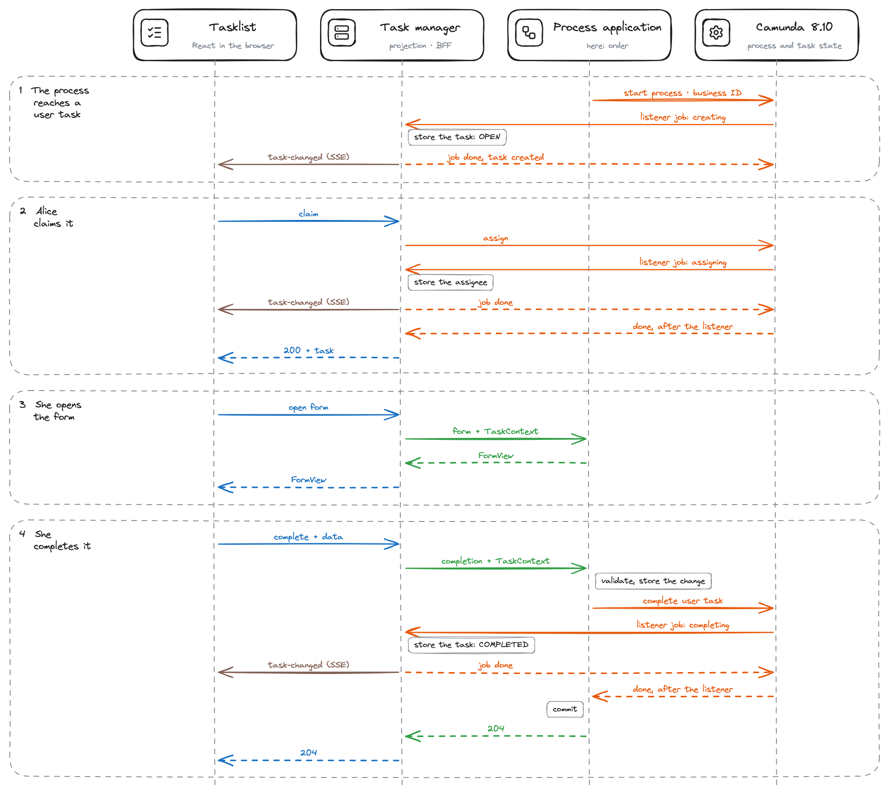

# camunda8-external-tasklist

You run several process applications on one Camunda 8 cluster, each with its own forms, rules and data, and want one tasklist for all their user tasks. This recipe adds a task manager that sees every user task of the cluster through a global user task listener, and a tasklist that shows the forms the applications provide.

**Serves:** teams that run several self-contained process applications on Camunda 8.10 and want a single tasklist.


## Ingredients

| Component | Version |
| --- | --- |
| Camunda 8 (orchestration cluster) | 8.10.9 |
| Elasticsearch (Camunda's secondary storage) | 9.5.6 |
| PostgreSQL | 18.6 |
| Java | 25 |
| Spring Boot / Kotlin | 4.1.2 / 2.4.21 |
| Process Engine API (bpm-crafters) / its C8 adapter, core | 1.7 / 2026.09.1 |
| React / JSON Forms / nginx (tasklist) | 19.3 / 3.8 / 1.31.8 |
| Node.js (downloaded by the build) / Playwright | 26.13.0 / 1.64.1 |

You need a JDK 25, Docker or Podman with Compose and about 6 GB of memory; `./e2e.sh` also needs Node.js. Versions are pinned in `pom.xml`, `stack/docker-compose.yml` and the `package.json` files.

## How it works




1. **The applications model plain Camunda user tasks.** Each task names its form (`externalReference="check-order@1"`) and its application (task header `domain`); the [contract](docs/architecture.md#contract-of-a-process-application) lists the rest. The applications never call the task manager.
2. **One global user task listener reports every task.** The task manager registers it at startup. Camunda hands each `creating`, `assigning`, `updating`, `completing` and `canceling` event to the task manager and waits, so its PostgreSQL projection is current before the process moves on.
3. **Claim, unclaim and update are Camunda commands.** Camunda owns the task; the commands return after the listener ran.
4. **Forms and completions belong to the application.** The task manager forwards them with a `TaskContext` from its projection. The application validates, stores its change and completes the task in one transaction, and its answer (`204`, `422`, `409`) reaches the user unchanged. HTML forms run in a sandboxed iframe and speak a small [postMessage protocol](tasklist-contract/src/main/typescript/PROTOCOL.md).
5. **Cancellations show at once.** An interrupting boundary event fires `canceling`, and the open task turns read-only. What no listener reports, such as a process instance modification, a reconciler closes later.

The tasklist runs behind nginx on port 3000 and talks only to the task manager. The applications call each other only over REST, never through Camunda messages, and reach Camunda through the [Process Engine API](https://github.com/bpm-crafters/process-engine-api); only their package `engine.camunda` knows Camunda. Each service owns its database.

| Folder | What it is |
| --- | --- |
| [`tasklist-contract/`](tasklist-contract) | The provider API `/tasklist/v1` with `@EnableTasklistProvider`, `TaskContext`, `FormView` and the form protocol |
| [`taskmanager/`](taskmanager) | Listener, projection, the tasklist API `/api`, forwarding, reconciler, server-sent events |
| [`processes/order/`](processes/order), [`processes/payment/`](processes/payment) | The two process applications: their processes, forms, micro-frontend and REST APIs |
| [`tasklist/`](tasklist) | The tasklist in the Miragon design ([design record](docs/design/decision.md)) |
| [`stack/`](stack), [`e2e/`](e2e) | The compose stack and the Playwright specs of `./e2e.sh` |
| [`docs/`](docs) | [Architecture and contracts](docs/architecture.md), [OpenAPI documents](docs/api), [history](docs/history) |

## Cook it

```bash
./mvnw -B -DskipTests package
docker compose -f stack/docker-compose.yml up -d --wait
```

Open <http://localhost:3000> and choose a demo user in the top right:

1. As **Alice** (sales), click **New order**, send the start form, claim *Check order* and approve it.
2. As **Bob** (finance), claim *Check payment* and enter a wrong amount: the error appears at the field. Complete it with the invoice amount.
3. As **Carol** (warehouse), claim *Prepare delivery*, save a draft and complete it. `demo` is in all three groups.

Cancel a second order while its *Check order* is open (the order number is in the task's subject), and the task turns read-only at once:

```bash
curl -s -X POST -H 'Content-Type: application/json' localhost:8081/api/v1/orders/ORD-1002/cancellation -d '{"reason": "Changed my mind"}'
```

| URL | What |
| --- | --- |
| <http://localhost:8090/swagger-ui.html> | Task manager API; it answers curl too, with the header `X-Demo-User: alice` |
| <http://localhost:8080/operate> | Operate, log in with `demo` / `demo` |
| <http://localhost:8081/swagger-ui.html>, <http://localhost:8082/swagger-ui.html> | Orders and payments APIs |

`docker compose -f stack/docker-compose.yml down -v` removes all data.

## Taste test

`./mvnw -B verify` (the `build` of `recipe.yaml`) runs the contract tests of the provider API, the projection tests on PostgreSQL, one Camunda Process Test class per service against Camunda 8.10.9 in Testcontainers, the OpenAPI documents in `docs/api` against the code, and lint, type check, tests and build of the tasklist and the micro-frontend.

`./e2e.sh` builds everything, starts the stack and runs the Playwright specs:

- `e2e/api` against the services: one order through both applications with field errors and a draft, the cancellation by the boundary event and the reconciler, the guards (only candidates claim, only the assignee completes, unknown users get `401`, the applications answer only the task manager's token, fields the form may not change cannot be forged), and the filters;
- `e2e/ui` in Chromium against the tasklist: filters and keyboard, the start form, the sandboxed iframe of *Check order*, the field errors of *Check payment*, and a cancellation that shows without a reload.

`KEEP_STACK=1` keeps the stack running, `UPDATE_SCREENSHOT=1` takes `images/tasklist.png` again. On Linux, run `npx playwright install-deps chromium` in `e2e/` once (it needs root).

## Take it home

1. Model the user tasks along the [contract](docs/architecture.md#contract-of-a-process-application): a versioned `externalReference`, the task header `domain`, the `businessId` of the instance and an optional `subject` variable.
2. Add `io.miragon.recipes:tasklist-contract`, put `@EnableTasklistProvider` on the application and write one `TaskFormHandler` per form version (and a `StartFormHandler` per start form). Complete tasks with `completeUserTask` on a `UserTaskCompletionApi`; `engine/camunda` in either application shows how to wire the C8 adapter. Set `tasklist.provider.token`, and `tasklist.provider.frame-bundle` for HTML forms. Keep `camunda.client.request-timeout` above Camunda's 15 s.
3. Register it in the task manager: `taskmanager.applications.<domain>.label`, `.base-url` and `.token`.

The task manager's settings are in `taskmanager/src/main/resources/application.yaml`:

| Property | Value | Meaning |
| --- | --- | --- |
| `taskmanager.listener.id` / `.retries` / `.priority` | `taskmanager-projection` / `10` / `0` | The global user task listener; its job type is `taskmanager.projection` |
| `taskmanager.applications.<domain>.{label,base-url,token}` | order, payment | Applications the task manager forwards to |
| `taskmanager.users.<id>.{name,groups}` | alice, bob, carol, demo | Demo users |
| `taskmanager.provider-timeout` | `25s` | Read timeout for calls to the applications; above Camunda's 15 s |
| `taskmanager.reconciler.{interval,lag,missing-grace,batch-size}` | `30s`, `10s`, `30m`, `100` | Reconciler |
| `camunda.client.request-timeout` | `20s` in every service (client default 10 s) | Above Camunda's 15 s, so a slow listener chain answers `504` and a completion `202` |

## Kitchen notes

- **Every user task in the cluster waits for the task manager.** The listener blocks each transition. While the task manager is down, tasks wait in `CREATING`, `COMPLETING` and so on, and commands answer `504` after 15 s; nothing is lost. A listener job that fails waits 2 s, 4 s and so on up to a minute and raises an incident after 10 attempts. Keep its handler to the database write.
- **A process instance modification does not trigger `canceling`.** The reconciler closes such tasks after about `interval` + `lag`, with more than `batch-size` open tasks after a few rounds; a completion attempt finds them gone at once.
- **Camunda's search lags about a second** behind, also for the BPMN XML and the listener registration. Only the reconciler, the background load of BPMN XML and the form reference lookup read it.
- **The task manager does not use the Process Engine API.** The API has no blocking listener with job keys, no claim and no search, so the task manager keeps the Camunda client in its package `camunda`, behind three ports.
- **The C8 adapter 2026.09.1 has three gaps that `engine.camunda` fills.** It drops the business ID on start, it publishes messages instead of correlating them (an early payment result would wait an hour instead of getting `503`), and it keeps no handle to close its job workers. The adapter's Spring Boot starter is not used, and `process-engine-worker` needs Spring Boot 3.5, so a small `ServiceTaskWorkers` helper answers the jobs.
- **Camunda keys exceed JavaScript's safe integers.** Every API of the recipe sends them as strings.
- **The Camunda client brings Apache HttpClient 5,** which a `RestClient` picks by default and which silently repeats a request that got `503`. The services use the JDK HTTP client.
- **springdoc reads Kotlin nullability through Jackson 2.** Without `com.fasterxml.jackson.module:jackson-module-kotlin` at runtime, the OpenAPI documents mark no field as required.
- **JSON Forms' default validator fails under a strict content security policy:** Ajv compiles schemas with `new Function`. The tasklist validates with `@cfworker/json-schema` instead ([`schemaValidator.ts`](tasklist/src/forms/schemaValidator.ts)).
- **Each tab holds a connection for the server-sent events.** Over HTTP/1.1 a browser opens at most six per host; serve the tasklist over HTTP/2 if people work with many tabs.
- **Two systems, one action.** A process start commits the application's database only if Camunda accepted it, a completion also when Camunda's answer is late or lost (`202`). A lost answer can leave a process running without its row, or a stored change on a task that stays open; use an outbox if you cannot accept that.
- **Demo only:** no authentication (`X-Demo-User`), static tokens between the task manager and the applications, no authentication on the applications' own REST APIs, server-sent events from one task manager instance only, and no data after `down -v`.
- **Version exceptions.** Java stays on the 25 LTS and Flyway on the Spring Boot BOM (12.4). Camunda minor and major upgrades and Elasticsearch majors are migrations, so Dependabot ignores them. The frontends stay on TypeScript 6 until typescript-eslint supports 7, and Dependabot does not update the Node version in `pom.xml`.

## Variations

| Instead of | You could | Better when |
| --- | --- | --- |
| Forms owned by the applications | Camunda Forms rendered by the tasklist with form-js | Forms are simple and domain checks fit into a `completing` listener |
| The Process Engine API in the applications | The Camunda client (`CamundaClient`, `@JobWorker`) | You stay on Camunda 8 and want its whole API without adapter code |
| A global user task listener | A custom exporter of `USER_TASK` records | You run self-managed only and transitions must not block |
| A global user task listener | Polling `POST /v2/user-tasks/search` | Few tasks and no need to see cancellations as events |
| REST between the services | An event bus such as Kafka | The services must not depend on each other being up |
| A static application registry | Self-registration of the applications | Many applications that come and go |
| Demo users | OIDC tokens with candidate groups from their claims | Always in production |

The [history](docs/history) folder keeps the master's thesis this recipe started from, with its original design of job-worker-based user tasks, an exporter and Kafka.
