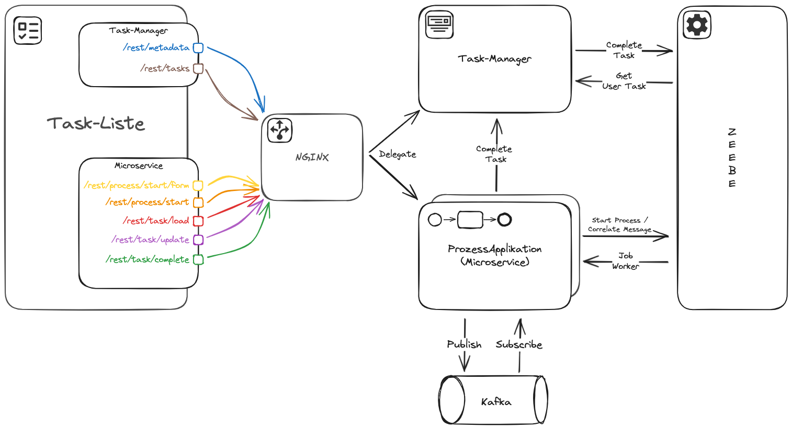
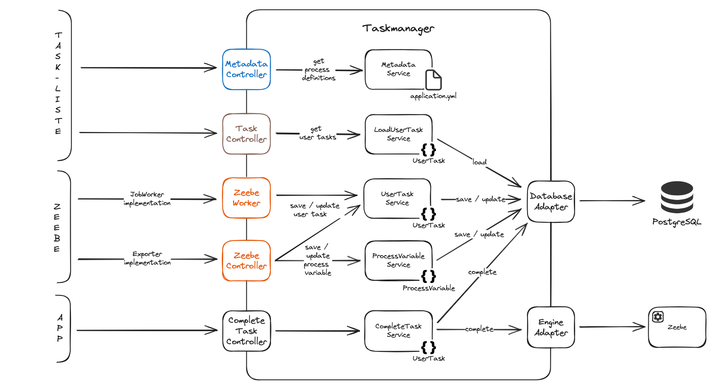
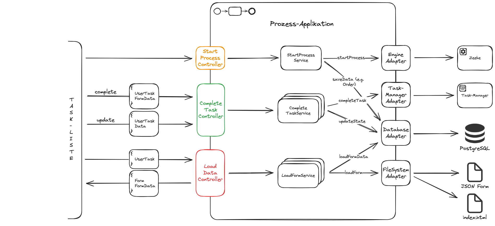

# zeebe-external-tasklist

Camunda 8's Tasklist shows every user task in one place, but in a microservice landscape each service owns its process, its data and its forms. This recipe runs your own tasklist on Zeebe: a task manager collects the user tasks of all process applications, and each process application renders and completes its own tasks.

**Serves:** teams on Camunda 8 who need their own tasklist UI or task store across several process services.

## Ingredients

| Component | Version |
| --- | --- |
| Camunda 8 (Zeebe, Operate) | 8.5.6 (Operate 8.5.5) |
| Spring Boot | 3.2.3 |
| Kotlin | 2.0.0 |
| Java | 17 |

You need a JDK 17, Maven, and Podman or Docker with Compose. The stack also starts Elasticsearch, Kafka and PostgreSQL. Versions are pinned in `pom.xml` and `stack/docker-compose.yml`.

## How it works



| Folder | What it does |
| --- | --- |
| [`taskmanager`](taskmanager) | Stores user tasks and their variables in PostgreSQL, serves them to the tasklist and completes them on Zeebe. |
| [`zeebe-user-task-exporter`](zeebe-user-task-exporter) | A Zeebe exporter that pushes user task and variable records to the task manager. |
| [`tasklistApi`](tasklistApi) | The OpenAPI contract between tasklist and task manager. |
| [`processes`](processes) | Two process applications, `order` and `payment`, talking to each other via Kafka. Each one serves the forms of its own tasks. |
| [`apps/tasklist`](apps/tasklist) | The React tasklist. It loads the forms from the process application that owns the task. |
| [`stack`](stack) | Compose stack with Zeebe, Operate, Elasticsearch, Kafka, PostgreSQL and an nginx in front of everything. |

The task manager learns about user tasks in one of two ways, switched by `miranum.tm.exporter` (`TM_USE_EXPORTER`):

1. **Job worker (default).** `UserTaskListener` subscribes to the job type `io.camunda.zeebe:userTask` and completes the job when the task is done.
2. **Exporter.** The broker loads `zeebe-user-task-exporter`, which posts records to `/rest/user_task/*`. The task manager then completes the task with the user task command.





## Cook it

```bash
mvn --batch-mode verify
cd stack
docker compose --profile prod up -d
```

Starting the stack may take a while. Then open:

- Tasklist: <http://localhost:8080>
- Operate: <http://localhost:8081> (`demo` / `demo`)

## Taste test

There is no end-to-end test yet. CI runs `mvn --batch-mode --update-snapshots verify`, which builds all modules and runs the task manager's unit tests.

## Take it home

- **Your own task store:** copy `taskmanager` and keep `tasklistApi` as its contract.
- **Push instead of poll:** copy `zeebe-user-task-exporter` and register it in the broker as in [`stack/zeebe/exporter.yml`](stack/zeebe/exporter.yml): set `baseUrl` to your task manager and mount the jar into `/usr/local/zeebe/lib/`.
- **Forms per service:** each process application exposes `/rest/task/load` and `/rest/task/complete`, and the task manager knows where to find it through `miranum.tm.metadata.process-application.<bpmnProcessId>.base-url`.

## Kitchen notes

- **The exporter is off by default.** To use it, uncomment the exporter lines of the `zeebe` service in `stack/docker-compose.yml` and set `TM_USE_EXPORTER` to `true` on the `taskmanager` service. Both switches must match, because the task manager completes tasks differently in each mode.
- **The exporter delivers at least once.** It acknowledges a record only after the task manager answered. A 5xx answer makes the broker retry; a 4xx answer is logged and skipped. The task manager therefore treats repeated records as idempotent.
- **The exporter reaches the task manager via the host.** `baseUrl` points to `host.docker.internal:8090`, as does nginx. On Linux, give the `zeebe` service the same `extra_hosts: host.docker.internal:host-gateway` entry that nginx has.
- **The stack is for development only.** Security is disabled on Elasticsearch, and all services use demo credentials.
