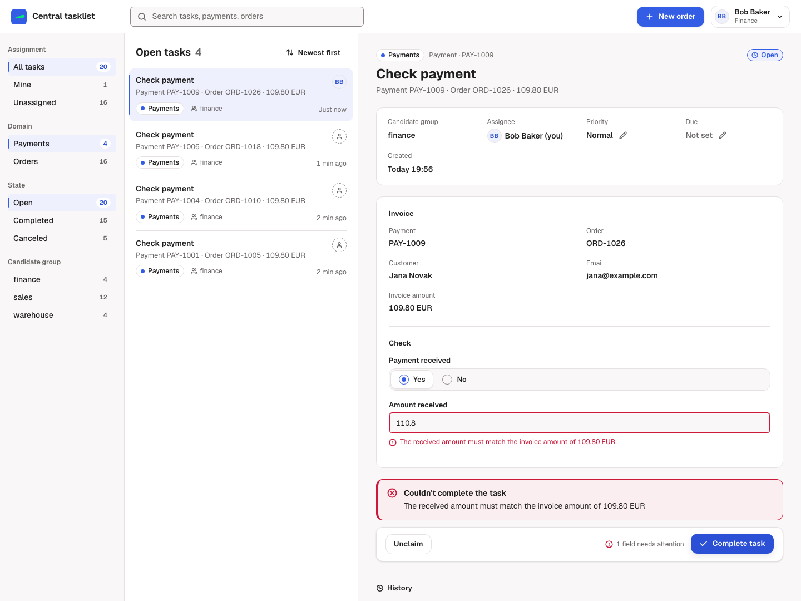
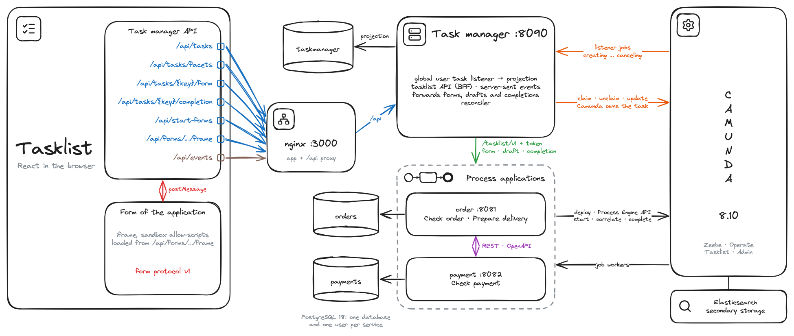

# camunda8-external-tasklist

You run several process applications on one Camunda 8 cluster, each with its own forms, rules and data, and want one tasklist for all their user tasks. This recipe adds a task manager that sees every user task of the cluster through a global user task listener, and a tasklist that shows the forms the applications provide.

**Serves:** teams that run several self-contained process applications on Camunda 8.10 and want a single tasklist.



## Ingredients

| Component | Version |
| --- | --- |
| Camunda 8 (orchestration cluster) | 8.10.9 |
| Elasticsearch (Camunda's secondary storage) | 9.5.6 |
| PostgreSQL | 18.6 |
| Spring Boot | 4.1.2 |
| Kotlin | 2.4.21 |
| Java | 25 |
| Node.js (downloaded by the build) | 26.13.0 |
| React (tasklist, micro-frontend of the order application) | 19.3 |
| JSON Forms (tasklist) | 3.8 |
| nginx (serves the tasklist) | 1.31.8 |
| Playwright | 1.64.1 |

You need a JDK 25 and Docker or Podman with Compose and about 6 GB of memory for it. `./e2e.sh` also needs Node.js; the Maven build downloads its own. Camunda, Spring Boot and Kotlin are pinned in `pom.xml`, the images in `stack/docker-compose.yml`, the frontend and test packages in their `package.json`.

## How it works



1. **The applications model plain Camunda user tasks.** Each task names its form with `zeebe:formDefinition externalReference="check-order@1"` (*Custom form key* in the Modeler) and its application with the task header `domain`. The applications never call the task manager. The [BPMN conventions](docs/architecture.md#contract-of-a-process-application) list everything.
2. **One global user task listener reports every task.** At startup the task manager registers a listener for all user task events in the cluster (`POST /v2/global-task-listeners`). Camunda hands each `creating`, `assigning`, `updating`, `completing` and `canceling` event to the task manager's job worker and waits for it. The worker writes the task into a PostgreSQL projection that the tasklist filters on.
3. **Claim, unclaim and update go through Camunda's REST API.** They return after the listener ran, so the projection is already up to date.
4. **Forms come from the application that owns the task.** The task manager forwards the form request with a `TaskContext` it builds from its projection. The application answers with a JSON Forms schema and data, or with an HTML micro-frontend. The micro-frontend runs in a sandboxed iframe and speaks a small [postMessage protocol](tasklist-contract/src/main/typescript/PROTOCOL.md).
5. **The application validates and completes.** It stores its domain change and completes the user task in one transaction. Its answer (`204`, `422` with field errors, `409` when the task is gone) reaches the user unchanged.
6. **A canceled task turns read-only at once.** An interrupting boundary event fires the `canceling` listener. The projection marks the task `CANCELED` and pushes a server-sent event. A completion attempt gets `409`.
7. **A reconciler covers the rest.** It closes tasks that a process instance modification ended (that skips the `canceling` listener) and picks up tasks the listener never reported.
8. **The tasklist shows filters, list and the open task side by side.** It renders JSON forms itself and loads HTML forms into the iframe, keeps the filters and the open task in the URL, and reloads what it shows on every server-sent event. nginx serves it on port 3000 with a strict content security policy and passes `/api` to the task manager, so the browser talks to nothing else. The [design record](docs/design/decision.md) explains its layout.

| Folder | What it is |
| --- | --- |
| [`tasklist-contract/`](tasklist-contract) | The contract between the task manager and the applications: `TaskContext`, `FormView`, the provider API `/tasklist/v1` with `@EnableTasklistProvider`, and the form protocol in TypeScript |
| [`taskmanager/`](taskmanager) | Global listener, projection, the API of the tasklist (`/api`), forwarding to the applications, reconciler, server-sent events |
| [`processes/order/`](processes/order) | Order application: the order process (with the interrupting boundary event on *Check order*), its React micro-frontend in `frontend/`, the JSON form of *Prepare delivery*, the orders API |
| [`processes/payment/`](processes/payment) | Payment application: the payment process with reminder and overdue timers, the JSON form of *Check payment*, the payments API |
| [`tasklist/`](tasklist) | The central tasklist in the Miragon design: React, Vite, TanStack Query and JSON Forms, built and tested by Maven |
| [`stack/`](stack) | Compose file with Camunda, Elasticsearch, PostgreSQL, the three services and nginx for the tasklist, with its [configuration](stack/nginx/tasklist.conf) |
| [`e2e/`](e2e) | Playwright specs that `./e2e.sh` runs against the stack: `api/` against the services, `ui/` in Chromium against the tasklist |
| [`docs/`](docs) | [Architecture and contracts](docs/architecture.md), [OpenAPI documents](docs/api), the [design of the tasklist](docs/design/decision.md) and the [history](docs/history) of the recipe |

The order and payment applications talk to each other only through their REST APIs (`POST /api/v1/payments` with a callback URL, `POST /api/v1/orders/{id}/payment-result`). Each correlates Camunda messages only into its own process.

## Cook it

```bash
./mvnw -B -DskipTests package
docker compose -f stack/docker-compose.yml up -d --wait
```

Open <http://localhost:3000> and choose a demo user in the top right:

1. As **Alice** (sales), click **New order** and send the order application's start form. Its *Check order* task opens: claim it and approve the order in the order application's form.
2. As **Bob** (finance), claim *Check payment* and enter a wrong amount. The payment application refuses it, and the error appears at the field. Complete it with the invoice amount.
3. As **Carol** (warehouse), claim *Prepare delivery*, save a draft, look at another task and come back, then complete it.

Place a second order and cancel it while its *Check order* is open; the order number is in the subject of the task. The task turns read-only at once, without a reload:

```bash
curl -s -X POST -H 'Content-Type: application/json' localhost:8081/api/v1/orders/ORD-1002/cancellation -d '{"reason": "Changed my mind"}'
```

The tasklist does everything through the task manager's API, so it also works without a browser. Place an order as Alice and list the tasks of the order application:

```bash
curl -s -H 'X-Demo-User: alice' localhost:8090/api/start-forms/order/new-order/form   # the catalog: city-helmet, light-set, ...
curl -s -X POST -H 'X-Demo-User: alice' -H 'Content-Type: application/json' \
  localhost:8090/api/start-forms/order/new-order/submission \
  -d '{"data": {"customer": {"name": "Anna Schmidt", "email": "anna@example.com", "address": "Lindwurmstr. 12, 80337 München"},
       "items": [{"itemId": "city-helmet", "quantity": 1}, {"itemId": "light-set", "quantity": 1}]}}'
curl -s -H 'X-Demo-User: alice' 'localhost:8090/api/tasks?domain=order'
```

The answer names the order in `businessId`. Cancel it while *Check order* is open and watch the task change to `CANCELED`:

```bash
ORDER=ORD-1001   # the businessId of the answer
curl -s -X POST -H 'Content-Type: application/json' localhost:8081/api/v1/orders/$ORDER/cancellation -d '{"reason": "Changed my mind"}'
curl -s -H 'X-Demo-User: alice' 'localhost:8090/api/tasks?state=CANCELED'
```

| URL | What |
| --- | --- |
| <http://localhost:3000> | The tasklist; choose a demo user in the top right |
| <http://localhost:8090/swagger-ui.html> | Task manager API |
| <http://localhost:8080/operate> | Operate, log in with `demo` / `demo` |
| <http://localhost:8081/swagger-ui.html>, <http://localhost:8082/swagger-ui.html> | Orders and payments APIs |

| Demo user | Groups |
| --- | --- |
| `alice` | sales: *Check order* |
| `bob` | finance: *Check payment* |
| `carol` | warehouse: *Prepare delivery* |
| `demo` | all three |

`docker compose -f stack/docker-compose.yml down -v` removes all data. To run a service from your IDE, stop its container and start it with the defaults in its `application.yaml`.

## Taste test

`./mvnw -B verify` (the `build` of `recipe.yaml`) runs:

- the contract tests of the provider API: token, binding to the editable fields only, problem details, the frame's content security policy;
- the projection tests on PostgreSQL: redeliveries and late listener jobs are ignored, tasks a listener closed never reopen, the filters;
- one Camunda Process Test class per service against Camunda 8.10.9 in Testcontainers:
  - task manager: listener, claim, update, completion through the application, cancellation by a boundary event, modification plus reconciler;
  - order: approval, decline, cancellation on *Check order*, payment results, delivery;
  - payment: idempotent payments API, the timers, the callback with retries;
- the OpenAPI documents in `docs/api` against the code;
- lint, type check, tests and build of the tasklist and the micro-frontend. The tasklist's tests cover its side of the form protocol, the API client, the filters in the URL, JSON Forms validation and errors, live updates, and its API types against `docs/api/taskmanager.json`.

`./e2e.sh` builds the jars and the tasklist, starts the stack and runs the Playwright specs: `e2e/api` against the services, `e2e/ui` in Chromium against the tasklist on port 3000.

| Spec | Proves |
| --- | --- |
| `api/order-to-delivery` | One order goes through *Check order* (micro-frontend, 422 without a reason), *Check payment* (JSON form, 422 for a wrong amount) and *Prepare delivery* (draft, 422, completion) across both applications |
| `api/cancellation` | The customer's cancellation cancels the open task through the boundary event; it gets `CANCELED`, read-only and `409` on completion. A modification is closed by the reconciler |
| `api/guards` | Only candidates claim, only the assignee completes, unknown users get `401`, the applications refuse calls without the task manager's token, read-only fields cannot be forged |
| `api/filters` | Domain, candidate group, assignment, text search and facets over both applications |
| `ui/list` | The desk filters by domain, assignment, candidate group, search and state; the list works with the arrow keys and Enter |
| `ui/start-order` | A new order starts from the order application's start form, and its first task opens |
| `ui/check-order` | *Check order* runs in the order application's iframe: `sandbox` is exactly `allow-scripts`, the frame's origin is `null`, it cannot reach the tasklist's page or storage, and a forged message completes nothing |
| `ui/check-payment` | Bob claims *Check payment*, the application refuses a wrong amount with a field error, and the invoice amount completes the task |
| `ui/cancel` | A canceled order turns its open task read-only at once, without a reload |

Set `KEEP_STACK=1` to keep the stack running after the test, and `UPDATE_SCREENSHOT=1` to take `images/tasklist.png` again. On Linux, install Chromium's system packages once with `npx playwright install-deps chromium` in `e2e/` (it needs root); CI does that itself.

## Take it home

**Join the tasklist with another process application:**

1. Model the user tasks along the [BPMN conventions](docs/architecture.md#contract-of-a-process-application): `externalReference` with a versioned form reference, the task header `domain`, the `businessId` of the instance and an optional `subject` variable.
2. Add `io.miragon.recipes:tasklist-contract`, put `@EnableTasklistProvider` on the application and write one `TaskFormHandler` per form version (and a `StartFormHandler` per start form). Set `tasklist.provider.token`; if it serves HTML forms, also set `tasklist.provider.frame-bundle`.
3. Register it in the task manager: `taskmanager.applications.<domain>.label`, `.base-url` and `.token`.

**Configuration of the task manager** (`taskmanager/src/main/resources/application.yaml`):

| Property | Default | Meaning |
| --- | --- | --- |
| `taskmanager.listener.id` / `.retries` / `.priority` | `taskmanager-projection` / `10` / `0` | The global user task listener; its job type is `taskmanager.projection` |
| `taskmanager.applications.<domain>.{label,base-url,token}` | order, payment | Applications the task manager forwards to |
| `taskmanager.users.<id>.{name,groups}` | alice, bob, carol, demo | Demo users |
| `taskmanager.provider-timeout` | `25s` | Read timeout for calls to the applications; above Camunda's 15 s |
| `taskmanager.reconciler.{interval,lag,missing-grace,batch-size}` | `30s`, `10s`, `30m`, `100` | Reconciler |
| `camunda.client.request-timeout` | `20s` | Above Camunda's 15 s, so a slow listener chain arrives as `504` |

## Kitchen notes

- **Every user task in the cluster waits for the task manager.** The listener blocks each transition until its job is completed. While the task manager is down, tasks stay in `CREATING`, `ASSIGNING`, `COMPLETING` or `CANCELING`, and REST commands answer `504` after 15 s. Nothing is lost: the waiting jobs are handled when it is back. A listener job that fails (the database restarts, say) waits 2 s, 4 s and so on up to a minute before the next attempt; after 10 attempts it raises an incident, which you resolve in Operate. Keep the listener handler to one database write: this one looks up names in a cache, loads unknown BPMN in the background and pushes server-sent events from its own threads.
- **A process instance modification does not trigger `canceling`.** Camunda skips user task listeners when a modification terminates a task. The reconciler closes such tasks after about `interval` + `lag`, and a completion attempt finds them gone at once.
- **Camunda's search is eventually consistent.** User task details, BPMN XML and even `GET /v2/global-task-listeners/{id}` lag about a second behind. The task manager reads the listener jobs instead, treats `409` on registration as "already registered", and only the reconciler reads the search.
- **`@JobWorker(type = "${...}")` does not resolve placeholders.** The listener's job type is a constant, `taskmanager.projection`.
- **Camunda Process Test purges the cluster before every test**, the global listener included, and starts the keys over. The task manager's integration test registers the listener again and empties the projection in `@BeforeEach`.
- **Camunda keys exceed JavaScript's safe integers.** Every API of the recipe sends keys as strings.
- **The Camunda client brings Apache HttpClient 5,** which a `RestClient` picks by default and which silently repeats a request that got `503`. All service clients here use the JDK HTTP client.
- **springdoc reads Kotlin nullability through Jackson 2.** Without `com.fasterxml.jackson.module:jackson-module-kotlin` at runtime, the OpenAPI documents mark no field as required.
- **JSON Forms' default validator fails under a strict content security policy.** Ajv compiles schemas into code with `new Function`, which `script-src 'self'` forbids, so every JSON form breaks. The tasklist gives JSON Forms a validator built on `@cfworker/json-schema`, which interprets schemas instead ([`schemaValidator.ts`](tasklist/src/forms/schemaValidator.ts)).
- **A form frame that fails stays silent.** When an application cannot deliver its micro-frontend, the iframe shows the error but never sends `ready`. The tasklist notices only after 15 s and offers Retry.
- **Each tab holds a connection for the events.** Over HTTP/1.1 a browser opens at most six connections per host, so many open tabs slow each other down. Serve the tasklist over HTTP/2 if people work with many tabs.
- **Two systems, one action.** An application commits a process start only if Camunda accepted it, and a completion also when Camunda's answer is late or lost (`202`). So a lost answer can leave a process running without its row, or a stored change on a task that stays open. Use an outbox if you cannot accept that.
- **Demo only:** there is no authentication (`X-Demo-User`), the tokens between the services are static, and the stack keeps no data after `down -v`. Server-sent events only reach the clients of one task manager instance.
- **Version exceptions.** Java 25 is the LTS (Dependabot offered 27). Flyway follows the Spring Boot BOM (12.4). Camunda minor and major upgrades and Elasticsearch majors are migrations, so Dependabot ignores them. The tasklist and the micro-frontend stay on TypeScript 6 until typescript-eslint supports 7. The Node version in `pom.xml` is not updated by Dependabot.

## Variations

| Instead of | You could | Better when |
| --- | --- | --- |
| Forms owned by the applications | Camunda Forms (`zeebe:formDefinition formId`, `bindingType="deployment"`) rendered by the tasklist with form-js, fetched with `GET /v2/user-tasks/{key}/form` | Forms are simple and domain checks fit into a `completing` listener that denies with a reason |
| A global user task listener | A custom exporter that streams `USER_TASK` records | You run self-managed only and must not block task transitions; you then handle duplicates and lag yourself |
| A global user task listener | Polling `POST /v2/user-tasks/search` | Few tasks and no need to see cancellations as events |
| REST between the services | An event bus such as Kafka | The services must not depend on each other being up |
| A static application registry | Self-registration of the applications at startup | Many applications that come and go; secure the registration |
| Demo users | OIDC tokens; candidate groups from the token's claims | Always in production |

The [history](docs/history) folder keeps the master's thesis this recipe started from and its original design with job-worker-based user tasks, an exporter and Kafka.
