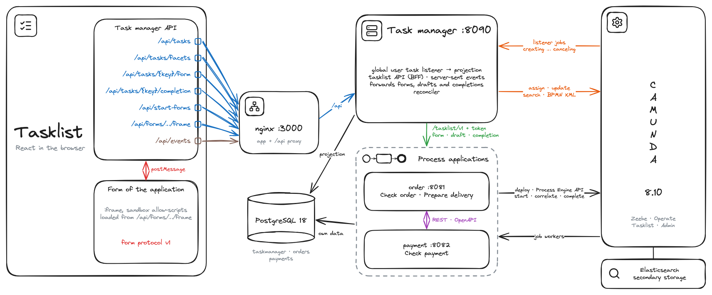
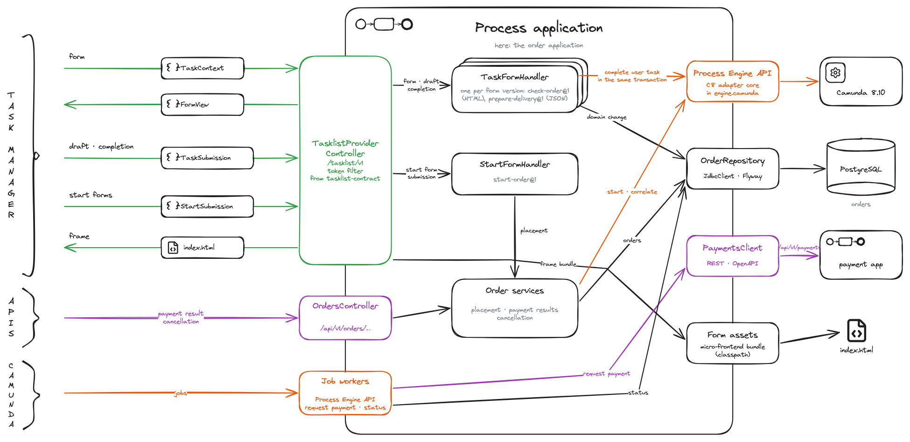
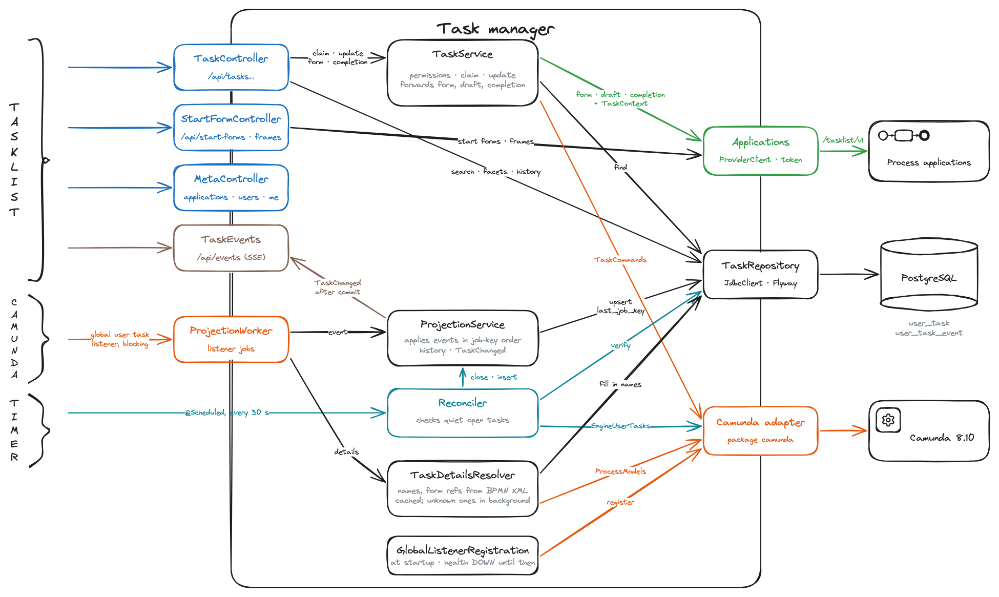

# Architecture

Several process applications run their processes on one Camunda 8.10 cluster, and one tasklist shows the user tasks of all of them. The task manager sits in between: it sees every user task through a global user task listener, keeps a projection for the tasklist and forwards forms and completions to the application that owns the task. The [README](../README.md) explains how to run it.



| Component | Owns |
| --- | --- |
| Camunda 8.10 (`:8080`) with Elasticsearch | process and user task state, variables; Operate at `/operate` |
| Task manager (`:8090`) | the task projection, the tasklist API `/api`, routing to the applications |
| Process applications: order (`:8081`), payment (`:8082`) | their processes, data, forms, validation and completion |
| Tasklist (nginx, `:3000`) | the UI; it talks only to the task manager |
| PostgreSQL | one database per service |

## What the task manager knows about an application

This is all it needs; the rest stays with the application:

| What | From | For |
| --- | --- | --- |
| Domain, label, base URL, token | registry `taskmanager.applications.<domain>` | routing, display, authentication |
| Keys, state, assignee, candidates, priority, dates | every listener job | projection, filters, permissions |
| `businessId`, for example the order number | the create command of the instance | search, the `TaskContext` |
| Task header `domain` (else the process ID) | the model | which application owns the task |
| `externalReference` `<form>@<version>` | the model | which form to ask for |
| Names of the task and the process | the BPMN XML, cached per definition | display |
| Variable `subject` | the process, before the first user task | one line in the list |

The applications declare no listener and never call the task manager.

## Contract of a process application

```xml
<bpmn:userTask id="checkOrder" name="Check order">
  <bpmn:extensionElements>
    <zeebe:userTask />
    <zeebe:formDefinition externalReference="check-order@1" />
    <zeebe:assignmentDefinition candidateGroups="sales" />
    <zeebe:taskHeaders><zeebe:header key="domain" value="order" /></zeebe:taskHeaders>
  </bpmn:extensionElements>
</bpmn:userTask>
```

Each application serves the provider API `/tasklist/v1` and checks the task manager's bearer token. The module `tasklist-contract` implements it: `@EnableTasklistProvider` and one `TaskFormHandler` per form version.



| Call | Body → answer |
| --- | --- |
| `POST /tasklist/v1/tasks/{key}/form` | `TaskContext` → `FormView`: `json-forms` with schema and data, or `html` for the micro-frontend |
| `POST /tasklist/v1/tasks/{key}/draft` | `{context, data}` → `204`; `405` if the form keeps no drafts |
| `POST /tasklist/v1/tasks/{key}/completion` | `{context, data}` → `204`; `202` accepted, not yet confirmed |
| `GET /tasklist/v1/start-forms` | → `[{id, formRef, label, description}]` |
| `POST /tasklist/v1/start-forms/{id}/form`, `…/submission` | `{user}` → `FormView`; `{user, data}` → `201 {processInstanceKey, businessId}` |
| `GET /tasklist/v1/forms/{formRef}/frame` | → the micro-frontend bundle with its own content security policy |

- **`TaskContext`** comes from the projection and the signed-in user, never from the browser: keys, `formRef`, `businessId`, state, assignee, candidate groups and `user {id, groups}`. The application loads its entities by business ID and binds only the fields the form may change.
- **Completion** belongs to the application: it validates, stores its change and completes the user task in one transaction. Camunda answers `204`: commit, `204`. `404`: roll back, `409`. Denied by a listener: roll back, `422`. `504` or no answer: commit, `202`. Unreachable: roll back, `503`.
- **Engine access** goes through the [Process Engine API](https://github.com/bpm-crafters/process-engine-api) 1.7: `StartProcessApi`, `CorrelationApi`, service tasks with `TaskSubscriptionApi` and `ServiceTaskCompletionApi`, user tasks with `UserTaskCompletionApi` and `completeUserTask` from `tasklist-contract`. Only the package `engine.camunda` knows Camunda: it wires the core of the C8 adapter 2026.09.1 and adds a start that sets the business ID and a correlation that answers at once when no instance waits.
- **Problems** are `application/problem+json` with a `code`: `BAD_REQUEST` (400), `UNAUTHORIZED` (401), `FORM_NOT_FOUND` (404), `DRAFT_NOT_SUPPORTED` (405), `TASK_NOT_ACTIVE` or `CONFLICT` (409), `VALIDATION_FAILED` (422), `UNAVAILABLE` (503). A `422` for invalid fields lists `errors: [{field, message}]` with dotted field paths; a listener's denial gives only its reason.
- **Versions.** A form reference carries its version: an incompatible change adds `check-order@2`, and `@1` stays while instances use it. The provider API is versioned in its path, the [form protocol](../tasklist-contract/src/main/typescript/PROTOCOL.md) of HTML forms in its messages.

The services call each other over REST with OpenAPI ([`api/`](api)), never through Camunda: each correlates messages only into its own processes. The calling job worker retries `5xx` and timeouts with backoff (the order application also `408` and `429`) and raises an incident for every other answer.

## Task manager



- **Global user task listener** `taskmanager-projection`: all events, after the listeners of the models, lowest priority, 10 retries with growing backoff, then an incident. The task manager registers it at startup and reports `DOWN` until then; the listener's handler only writes the projection.
- **Projection** `user_task` with the history `user_task_event`. Each listener event is one upsert guarded by `last_job_key`: redeliveries and late jobs change nothing, and a task the listener closed never reopens; the next listener event corrects one the reconciler closed. Apart from `subject` and the business ID, no variables, form or domain data are stored.
- **Tasklist API** `/api` ([OpenAPI](api/taskmanager.json)): tasks with filters and facets, claim, unclaim, update, form, draft, completion, start forms, frames, and server-sent events `task-changed {userTaskKey, state, domain}` without IDs to resume from. The user is `X-Demo-User`. Candidates claim and update (everyone, if the task names none); only the assignee unclaims, saves drafts and completes, and everyone else gets the form read-only. Commands return after Camunda ran the listeners, so the projection is current when the answer arrives.
- **Camunda** stays a direct dependency of the task manager, in its package `camunda` behind the ports `TaskCommands`, `EngineUserTasks` and `ProcessModels`: the Process Engine API has no blocking listener with job keys, no claim and no search.
- **Reconciler**, every 30 s: closes tasks Camunda reports as closed, and after 30 min tasks its search no longer knows; once after startup it inserts tasks created before the listener existed; it fills in missing names and form references.

| Trigger | Listener event | Projection |
| --- | --- | --- |
| The process reaches the task | `creating` | `OPEN` |
| Claim, unclaim, update | `assigning`, `updating` | assignee, fields |
| The application completes it | `completing` | `COMPLETED` |
| Interrupting boundary event or event subprocess, instance canceled | `canceling` | `CANCELED` |
| Process instance modification | none | `CANCELED` by the reconciler |

Listeners block. A task stays in `CREATING`, `COMPLETING` and so on until the listener job is done, and an interrupting boundary event waits for `canceling`. So the projection changes before the process moves on (a modification reaches it only through the reconciler), and the task manager is on the critical path of every user task in the cluster: while it is down, transitions wait and commands answer `504` after 15 s and are applied later. Nothing is lost.

## Tasklist

- **One origin:** nginx serves the app under `default-src 'self'` and passes `/api` to the task manager.
- **Forms:** JSON forms are rendered with JSON Forms and validated by `@cfworker/json-schema`, which needs no generated code under that policy. HTML forms run in an iframe with `sandbox="allow-scripts"` and speak form protocol v1.
- **Answers:** `422` puts errors at the fields, `409` and `403` reload the task, `202` locks the form until the task closes, and a form that answers `503` loads again after `Retry-After`; completions are never resent.

## Failure and consistency

| Situation | Behavior |
| --- | --- |
| Completion of a closed task | `409 TASK_NOT_ACTIVE` |
| Camunda slower than 15 s | `202`, applied later; claims and updates too |
| An application is down | `503` with `Retry-After`, projection unchanged |
| The form reference is not known yet | `503 SYNCING`; the model or the reconciler fills it in |

A process start or correlation commits only if Camunda accepted it, a completion also after `504` or no answer (`202`). So a lost answer can leave a process running without its row, or a stored change on a task that stays open; the recipe has no outbox for these gaps. Camunda's search lags about a second behind; only the reconciler, the background load of BPMN XML and the form reference lookup read it.

## Decisions and limits

| Decision | Instead of |
| --- | --- |
| Camunda user tasks and one global listener: every event in order and before the process moves on, nothing to declare in the models, available in SaaS too | job-worker user tasks, an exporter, polling the search |
| A projection in the task manager for filters, routing and history | Camunda's search on every request |
| Forms, validation and completion stay with the application | Camunda Forms rendered by the tasklist |
| The task manager is the browser's only backend, so the `TaskContext` comes only from it | forms loaded from each application |
| The Process Engine API in the applications; only `engine.camunda` knows Camunda | the Camunda client in every class |
| REST with OpenAPI between services | Camunda messages across services, Kafka |
| A static registry of applications | self-registration |

Limits:
- Every user task of the cluster passes the task manager, also those of processes that do not take part: in 8.10 a global listener cannot be limited to some processes.
- One worker thread handles the listener jobs of the whole cluster. A database outage of more than about 5 to 10 minutes turns the waiting jobs into incidents in every team's instances.
- The listener stays registered when the task manager stops. Delete it before you remove the task manager for good, or every user task waits.
- No real authentication: demo users and static tokens.
- Server-sent events reach the clients of one task manager instance only.
- Single tenant: the listener worker takes only jobs of the default tenant (`camunda.client.worker.defaults.tenant-ids`), so with multi-tenancy the user tasks of other tenants wait in `CREATING`.
