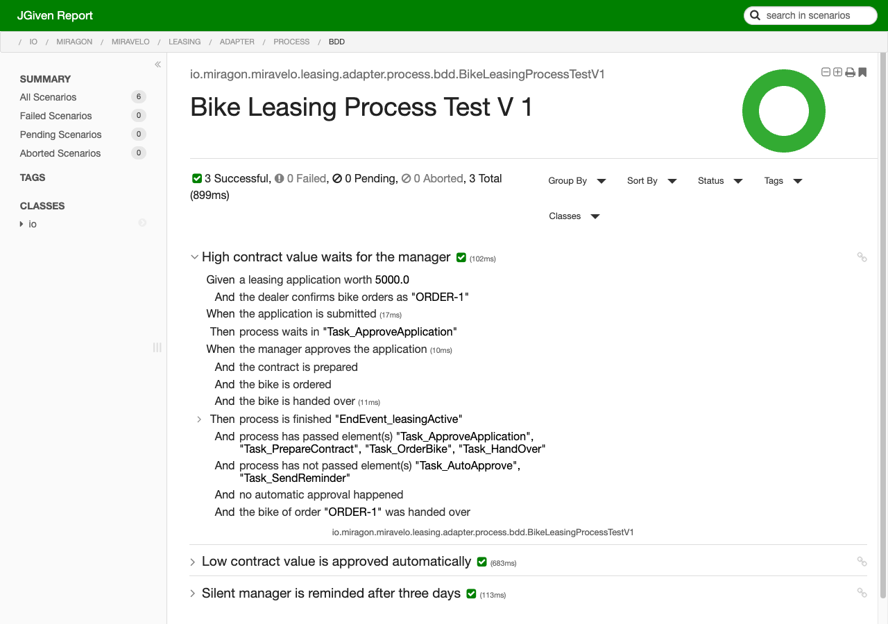
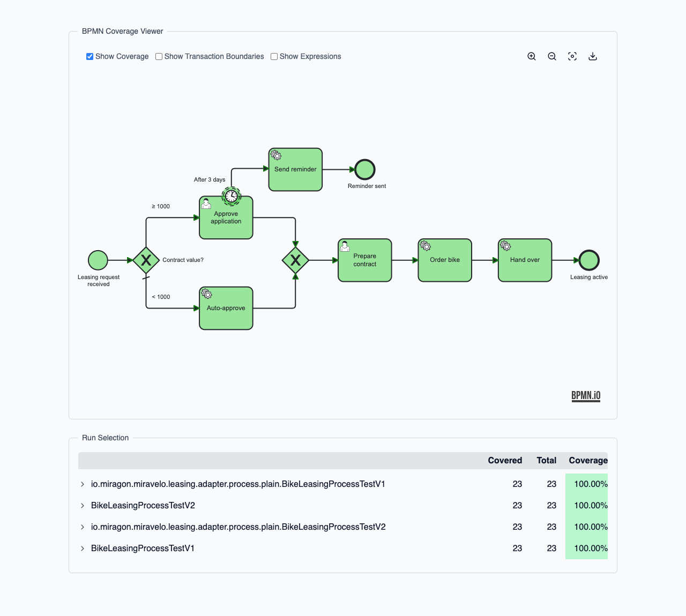

# cibseven-embedded-process-tests

A process test that completes service tasks by hand proves the model, but not the delegates behind it. This recipe tests a BPMN process on an embedded CIB seven engine with its real delegates and process adapter, once with CIB seven Assert and once behavior-driven with JGiven, each with and without a generated Process API.

**Serves:** Java developers who write process tests for CIB seven.



## Ingredients

| Component | Version |
| --- | --- |
| CIB seven | 2.2.0 |
| Spring Boot | 4.1.2 |
| Java | 21 |
| [JGiven](https://jgiven.org) | 2.0.3 |
| [bpmn-to-code](https://github.com/Miragon/bpmn-to-code) | 7.0.1 |

You need a JDK 21. `./mvnw` downloads Maven, and the engine runs on an in-memory H2 database. Versions, including [`cibseven-bpm-jgiven`](https://github.com/cibseven-community-hub/cibseven-bpm-jgiven) and Process Test Coverage 2.2.0, are pinned in [`pom.xml`](pom.xml).

## How it works

The process [`bike-leasing.bpmn`](src/main/resources/bpmn/bike-leasing.bpmn) is the bike order from chapter 5.2 of the CIB seven developer training. From a contract value of 1,000, a manager approves the application and gets a reminder after three days. Below that, a service task approves it automatically. Then the contract is prepared and the bike is ordered and handed over.

As in the [process-engine-blueprints](https://github.com/Miragon/process-engine-blueprints), each [delegate](src/main/java/io/miragon/miravelo/leasing/adapter/inbound/cibseven) calls one use case, and [`LeasingProcessAdapter`](src/main/java/io/miragon/miravelo/leasing/adapter/outbound/cibseven/LeasingProcessAdapter.java) starts the process and completes the user tasks.

The tests mock only the use cases. The service tasks are `asyncBefore` and the job executor is off, so each test runs the jobs itself and the real delegates execute. The tests sit in two packages under [`src/test/.../adapter/process`](src/test/java/io/miragon/miravelo/leasing/adapter/process):

| | [`plain`](src/test/java/io/miragon/miravelo/leasing/adapter/process/plain) | [`bdd`](src/test/java/io/miragon/miravelo/leasing/adapter/process/bdd) |
| --- | --- | --- |
| Engine | `@SpringBootTest` with the embedded engine | in-memory engine from `cibseven-bpm-junit5`, no Spring |
| Delegates | Spring beans, use cases as `@MockitoBean` | registered with `Mocks.register(...)` |
| Steps | `execute(job("Task_OrderBike", leasing))` | `the_bike_is_ordered()` in [`BikeLeasingStages`](src/test/java/io/miragon/miravelo/leasing/adapter/process/bdd/BikeLeasingStages.java) |
| Checks | CIB seven Assert: `hasPassedInOrder`, `isWaitingAt` | `ProcessStage` of `cibseven-bpm-jgiven` plus domain steps |

Each package holds `BikeLeasingProcessTestV1` and `BikeLeasingProcessTestV2` with the same three scenarios: automatic approval, manager approval and the reminder. V1 names elements by string id. V2 takes them from the [Process API](src/main/java/io/miragon/miravelo/leasing/adapter/process) that bpmn-to-code generates from the model, and describes the expected path as a walk along it with `PathWalk`. A renamed element then breaks the build, not the test run.

## Cook it

```bash
./mvnw -B verify
```

Then open `target/jgiven-reports/html/index.html` for the scenarios and `target/process-test-coverage/all/report.html` for the coverage. Run one package with `./mvnw clean verify -Dtest='**/plain/*'` or `-Dtest='**/bdd/*'`.

## Taste test

The build runs twelve process tests in four classes. Each checks the path, where the process waits, and what the delegates passed to the use cases, such as the `orderId` that `OrderBikeDelegate` writes and `HandOverBikeDelegate` reads. Change the condition of `Flow_value_to_manager` in `bike-leasing.bpmn` and all four classes fail.

Twelve unit tests check the pieces without an engine, in short given, when and then blocks: one per [delegate](src/test/java/io/miragon/miravelo/leasing/adapter/inbound/cibseven) against a mocked `DelegateExecution`, [`LeasingProcessAdapterTest`](src/test/java/io/miragon/miravelo/leasing/adapter/outbound/cibseven/LeasingProcessAdapterTest.java) against a mocked `RuntimeService` and `TaskService`, and one per [service](src/test/java/io/miragon/miravelo/leasing/application/service).

[Process Test Coverage](https://github.com/cibseven-community-hub/cibseven-process-test-coverage) merges all runs into one report:



## Take it home

Pick one style and copy its package together with its dependencies from [`pom.xml`](pom.xml):

- **CIB seven Assert (`plain`):** `cibseven-bpm-assert`, `cibseven-process-test-coverage-spring-test-platform-7` and `kotlin-reflect`. Copy `src/test/resources/application-test.yaml`, which turns the job executor off, and `META-INF/spring/org.springframework.boot.autoconfigure.AutoConfiguration.imports`, which switches coverage on.
- **JGiven (`bdd`):** `cibseven-bpm-assert`, `cibseven-bpm-junit5`, `cibseven-bpm-jgiven`, `jgiven-junit5` and `cibseven-process-test-coverage-junit5-platform-7`, plus the `jgiven-maven-plugin` and the `jgiven.report.dir` Surefire property. `InMemoryProcessEngine` sets the `MockExpressionManager` that `Mocks.register(...)` needs; point `@Deployment` at your model.
- **bpmn-to-code (V2):** `bpmn-to-code-runtime` and the `bpmn-to-code-maven` plugin. Its configuration sets the model pattern, the target package and `CAMUNDA_7` as engine; the generated API is committed.

Both styles also need the Surefire `**/*TestV*.java` include, or rename the classes to end in `Test`. The unit tests need nothing beyond `spring-boot-starter-test`.

## Kitchen notes

- **Surefire runs only `*Test` classes by default.** An explicit include replaces that default, so `pom.xml` lists both `**/*Test.java` and `**/*TestV*.java`.
- **Give every in-memory engine its own database.** `InMemoryProcessEngine` uses a random H2 name. With a fixed one, the second JGiven class in the same JVM fails with `Table "ACT_HI_PROCINST" already exists`.
- **Scope job queries to the instance.** The Spring engine lives across test classes. `job("Task_OrderBike", leasing)` finds only this instance's job.
- **Hand the engine to JGiven in a field initializer.** In `@BeforeEach` it comes too late and the stages fail with "The field camunda is required".
- **`Mockito.when` clashes with JGiven's `when()`.** Call it qualified inside a stage, and call `Mocks.reset()` after each JGiven test.
- **Nothing in `main` calls the process port.** In your service, a REST controller or message listener does; here the tests do.

## Variations

The [bpm-crafters process-engine-api](https://github.com/bpm-crafters/process-engine-api) runs the same tests through an engine-neutral adapter, as in the [`cibseven-process-engine-api`](https://github.com/Miragon/process-engine-blueprints/tree/main/examples/cibseven-process-engine-api) example. Choose it when your code must stay portable between engines. A remote engine with external task workers follows as its own recipe ([#247](https://github.com/Miragon/process-engine-recipes/issues/247)).
