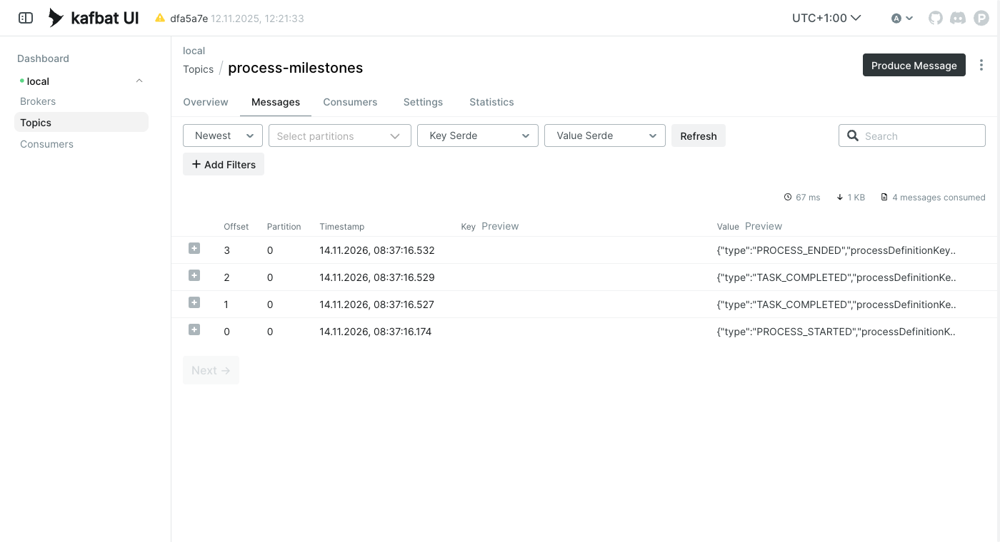
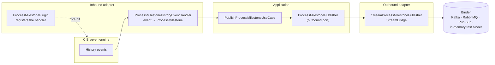
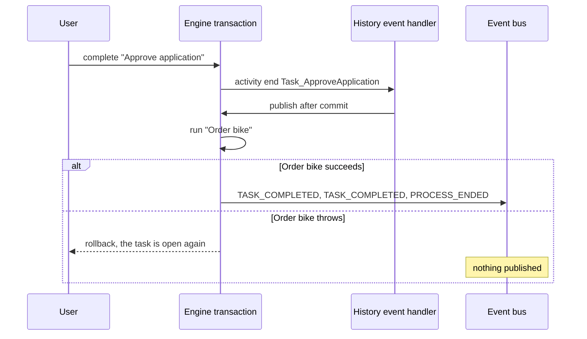

# cibseven-engine-plugin-history-events

Other systems want to know when a process starts, a task completes or a process ends, for every process on the engine and without a listener in each model. This recipe streams those milestones from the engine's history events to an event bus with a process engine plugin, and keeps the history in Cockpit.

**Serves:** Java developers who write their first CIB seven engine plugin, or who need to understand one they found.



## Ingredients

| Component | Version |
| --- | --- |
| CIB seven | 2.2.0 |
| Spring Boot | 4.1.2 |
| Spring Cloud Stream | 5.0.4 (Spring Cloud 2025.1.4) |
| Java | 21 |
| [bpmn-to-code](https://github.com/Miragon/bpmn-to-code) | 7.0.1 |
| Apache Kafka | 4.1.1, local runs only |

You need a JDK 21. The build and its tests need no broker and no containers. To watch real messages, you also need Docker or Podman with Compose. Versions are pinned in [`pom.xml`](pom.xml) and [`stack/docker-compose.yml`](stack/docker-compose.yml).

## How it works

A `ProcessEnginePlugin` is called once while the engine starts. In `preInit`, [`ProcessMilestonePlugin`](src/main/java/io/miragon/miravelo/leasing/adapter/inbound/cibseven/history/ProcessMilestonePlugin.java) adds one handler to the engine's custom history event handlers:

```java
@Override
public void preInit(ProcessEngineConfigurationImpl configuration) {
    configuration.getCustomHistoryEventHandlers().add(new ProcessMilestoneHistoryEventHandler(useCase));
}
```

From then on, the engine hands every history event to the default database handler and to [`ProcessMilestoneHistoryEventHandler`](src/main/java/io/miragon/miravelo/leasing/adapter/inbound/cibseven/history/ProcessMilestoneHistoryEventHandler.java). The handler keeps three kinds and drops the rest:

| History event | Milestone |
| --- | --- |
| process instance `start` | `PROCESS_STARTED` |
| activity instance `end` of a user task or service task | `TASK_COMPLETED` with the `activityId` |
| process instance `end` | `PROCESS_ENDED` |

The plugin is an inbound adapter like a delegate. Only the handler knows engine classes. The application sees a `ProcessMilestone` and a port, and only the outbound adapter knows the event bus:



[`StreamProcessMilestonePublisher`](src/main/java/io/miragon/miravelo/leasing/adapter/outbound/stream/StreamProcessMilestonePublisher.java) sends through Spring Cloud Stream's `StreamBridge` to the binding `processMilestones-out-0`. [`application.yaml`](src/main/resources/application.yaml) maps it to the destination `process-milestones`. Which broker that is depends on the binder on the classpath: Kafka at runtime, the in-memory test binder in tests. The code does not change.

History events are written inside the engine transaction. The handler therefore does not publish right away. It registers the publish on the engine's `COMMITTED` transaction listener, so a step that rolls back sends nothing:



The process [`bike-leasing.bpmn`](src/main/resources/bpmn/bike-leasing.bpmn) is the MiraVelo leasing from the CIB seven developer training, cut down to what the plugin needs: a user task "Approve application", a service task "Order bike" and an end event. [`OrderBikeDelegate`](src/main/java/io/miragon/miravelo/leasing/adapter/inbound/cibseven/OrderBikeDelegate.java) calls one use case.

## Cook it

Start Kafka and Kafka UI, then the application:

```bash
docker compose -f stack/docker-compose.yml up -d
./mvnw spring-boot:run
```

Start a leasing application and complete its approval through the engine's REST API:

```bash
curl -u admin:admin -H 'Content-Type: application/json' \
  -d '{"businessKey":"APP-4711"}' \
  http://localhost:8080/engine-rest/process-definition/key/bikeLeasingProcess/start

TASK_ID=$(curl -s -u admin:admin 'http://localhost:8080/engine-rest/task?processInstanceBusinessKey=APP-4711' | jq -r '.[0].id')
curl -u admin:admin -H 'Content-Type: application/json' -d '{}' \
  http://localhost:8080/engine-rest/task/$TASK_ID/complete
```

Kafka UI at http://localhost:8090 shows four messages on the topic `process-milestones`. The CIB seven web client at http://localhost:8080 (`admin` / `admin`) still shows the instance in its history. Each message is JSON like this:

```json
{"type":"TASK_COMPLETED","processDefinitionKey":"bikeLeasingProcess","processInstanceId":"36dfa725-…","businessKey":"APP-4711","activityId":"Task_ApproveApplication","occurredAt":"2026-11-14T07:37:16.470Z"}
```

Stop the stack with `docker compose -f stack/docker-compose.yml down`.

## Taste test

`./mvnw -B verify` runs [`HistoryEventsProcessTest`](src/test/java/io/miragon/miravelo/leasing/adapter/inbound/cibseven/history/HistoryEventsProcessTest.java) on the embedded engine with the test binder. It reads the destination through `OutputDestination` and checks three things:

- **All milestones, in order, once.** Start, approval and order produce exactly `PROCESS_STARTED`, two `TASK_COMPLETED` and `PROCESS_ENDED` with the business key.
- **Cockpit keeps its history.** The finished user task is still in `HistoryService`.
- **A rollback publishes nothing.** If `OrderBikeUseCase` throws, completing the approval fails, the task is open again and the destination stays empty. Publish without the `COMMITTED` listener and this test fails.

Unit tests without an engine cover the plugin, the delegate, the use case and the stream adapter.

## Take it home

Copy the package `adapter/inbound/cibseven/history` and adapt `toMilestone` to the events you need. Keep the port and the stream adapter, or point the use case at your own port. From [`pom.xml`](pom.xml) you need:

- `spring-cloud-dependencies` as an imported BOM, `spring-cloud-stream-binder-kafka` (or the binder of your broker) and `spring-cloud-stream-test-binder` for the tests.
- The `spring.cloud.stream` block of [`application.yaml`](src/main/resources/application.yaml): the binding `processMilestones-out-0`, its `destination` and the broker address.

Outside Spring Boot, on a shared engine or CIB seven Run, register the plugin in `bpm-platform.xml` or under `process-engine-plugins` and give it a publisher that does not need Spring.

## Kitchen notes

- **Do not make the handler a Spring bean.** The CIB seven Spring Boot starter adds a single `HistoryEventHandler` bean to the custom handlers on its own. If the plugin adds the same bean, every event arrives twice. Here the plugin creates the handler.
- **`isEventOfType` compares only the event name.** `PROCESS_INSTANCE_START` and `ACTIVITY_INSTANCE_START` are both `start`. Check the event class first (`HistoricProcessInstanceEventEntity`, `HistoricActivityInstanceEventEntity`), then the type.
- **Activity events carry no business key.** The handler reads it from the process instance execution in the current command context. `Context.getBpmnExecutionContext()` is `null` while history events are handled.
- **Publish after commit, and accept at-most-once.** An exception in the handler rolls back the process step. A publish in the `COMMITTED` listener cannot do that, but a failed send is lost. If consumers must see every milestone, write to an outbox table in the same transaction instead.
- **The plugin uses internal API.** `ProcessEngineConfigurationImpl`, `HistoryEvent` and `Context` live in `impl` packages. Retest the handler on every engine upgrade.
- **The history level must produce the events.** Spring Boot defaults to `full`. With `none`, the engine creates no history events and the handler receives nothing.
- **Kafka keeps order per partition only.** Without a message key, milestones of one instance can land on different partitions. Set a `partition-key-expression` such as `payload.processInstanceId` on the binding before you add partitions.
- **CIB seven 2.2.0 puts two web clients on the classpath.** `cibseven-webapp-webjar` pulls in `cibseven-webclient-web` for Spring Boot 3 next to the Spring Boot 4 one. The application then fails at start with `NoSuchMethodError: PathMatchConfigurer.setUseSuffixPatternMatch`. `pom.xml` excludes `org.cibseven.webapp:cibseven-webclient-web`.
- **Spring Cloud 2025.1 targets Spring Boot 4.0.** It builds and runs here on Boot 4.1.2. Move to Spring Cloud 2026.0 once it is released.
- **Demo only.** The JWT secret of the web client is committed, the user is `admin` / `admin`, H2 lives in memory and Kafka runs without authentication.

## Variations

- **Spring events instead of a plugin.** With `camunda.bpm.eventing.history: true`, the starter publishes history events as Spring application events, and an `@EventListener` can do what the handler does. Inside a Spring Boot application, that is the simpler choice. That starter feature is itself an engine plugin, and it does not exist on a shared engine or on CIB seven Run.
- **History only on the bus.** `enableDefaultDbHistoryEventHandler=false` stops the database history. Cockpit then shows no history, so choose it only when another system takes over that role.
