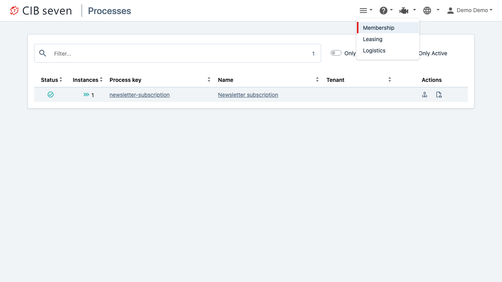

# cibseven-multi-engine-cockpit

Every service with an embedded CIB seven engine ships its own cockpit, so support has to know which service runs which process and open a different URL for each. This recipe deploys **one** CIB seven web client next to the services and lets it switch between their engines.

**Serves:** teams running several Spring Boot services with embedded engines and one support desk.



## Ingredients

| Component | Version |
| --- | --- |
| CIB seven | 2.2.0 |
| Spring Boot | 4.1.2 |
| Java | 21 |
| Gradle | 9.8.2 |
| Playwright | 1.64.1 |

You need a JDK 21 and Podman or Docker with Compose. All library versions are in `gradle/libs.versions.toml`. Tested with Podman and Docker Compose.

## How it works

```
                 ┌──► membership-service :8080/engine-rest   newsletter-subscription
Browser ──► webclient :8080/webapp
                 ├──► leasing-service    :8080/engine-rest   bike-leasing
                 └──► logistics-service  :8080/engine-rest   welcome-package
```

The three services come from the MiraVelo domain and contain no business logic: each one is a Spring Boot 4 application with `cibseven-bpm-spring-boot-starter-rest-4` (CIB seven ships its Spring Boot 4 starters with a `-4` suffix), an in-memory H2 database and a single process (start → user task → end). The open user task keeps instances visible in the cockpit.

The web client runs in its own container (`cibseven/cibseven:run4-2.2.0`, the Spring Boot 4 distribution of CIB seven Run, started with `--webapps` only). It calls the engines **server-side**, so the services do not need CORS and only the web client has to be reachable from the browser. The services publish no ports at all.

## Cook it

```bash
./e2e.sh                     # build, start the stack, start one instance per service, run the test, stop the stack
```

To look around yourself:

```bash
./gradlew bootJar
docker compose -f stack/docker-compose.yml up -d --wait
```

Open <http://localhost:8080/webapp>, pick an engine with the engine icon in the top menu and log in with `demo` / `demo`.

## Taste test

`e2e/switch.spec.ts` logs in, opens the engine selector and expects exactly Membership, Leasing and Logistics. Then, for each engine, it selects the engine, logs in and checks that the process list shows that service's process and none of the others. `UPDATE_SCREENSHOT=1 ./e2e.sh` refreshes the screenshot above.

## Take it home

`stack/webclient/application.yaml` is everything the web client needs:

```yaml
cibseven:
  webclient:
    engineRest:
      url: http://membership-service:8080
      path: /engine-rest
      displayName: Membership
      additionalEngineRest:
        - url: http://leasing-service:8080
          path: /engine-rest
          displayName: Leasing
        - url: http://logistics-service:8080
          path: /engine-rest
          displayName: Logistics
```

It is loaded next to the bundled configuration via `JAVA_OPTS=-Dspring.config.additional-location=file:/camunda/configuration/engines.yaml`. Adding a fourth service means adding one entry. The URLs are the ones the web client container sees, not the browser.

The services themselves need nothing beyond the REST starter and a user who may log in (`camunda.bpm.admin-user` with `demo` / `demo`).

## Kitchen notes

- **Keep each engine named `default`.** The web client calls `GET {url}{path}/configuration` without an engine name. A service whose engine has another `camunda.bpm.process-engine-name` makes the web client fail with `No process engine available`. Use `displayName` to tell the engines apart.
- **One login per engine.** Switching the engine logs the user out, and the user has to exist on the target engine. With a shared identity provider this is invisible. With the engine's own user tables, every service needs the user.
- **The engines are not secured in this demo.** The Spring Boot REST starter accepts every request, so the token the web client sends is not checked. For production, secure each engine REST API with the composite authentication filter (JWT with Basic fallback), give every engine its own secret via `CIBSEVEN_WEBCLIENT_AUTHENTICATION_JWTSECRET` (at least 155 Base64 characters) and repeat that secret as `jwtSecret` on the engine's `additionalEngineRest` entry. Without the entry, the web client signs with its own secret and the engine answers 401. The [official multi-engine example](https://github.com/cibseven/cibseven-multi-engine-example) shows this setup with CIB seven Run.
- **The web client container starts an engine of its own.** CIB seven Run has no web-client-only mode, so `--webapps` boots an unused in-memory engine as well. It is never shown, because `engineRest` points to the services.
- **The classic Cockpit does not help here.** Its engine dropdown at `/camunda/app/cockpit` only lists engines in the same JVM. Multi-engine across services needs the web client at `/webapp`.

## Variations

Instead of a central deployment, every service can embed the web client and list the other services' engines as `additionalEngineRest`:

```yaml
# in leasing-service
cibseven:
  webclient:
    engineRest:
      url: http://localhost:8080
      displayName: Leasing
      additionalEngineRest:
        - url: http://membership-service:8080
          displayName: Membership
        - url: http://logistics-service:8080
          displayName: Logistics
```

| | Central web client (this recipe) | Web client in every service |
| --- | --- | --- |
| Entry points for support | one | one per service |
| Engine list to maintain | one file | one per service (n² entries) |
| New service | one entry in one file | one entry in every other service |
| Deployments | one more container | none extra |
| Cockpit availability | depends on the web client | each service still has its own |

Choose the central web client as soon as more than two services or a support team are involved. The embedded variant only pays off when the services must stay operable on their own.
