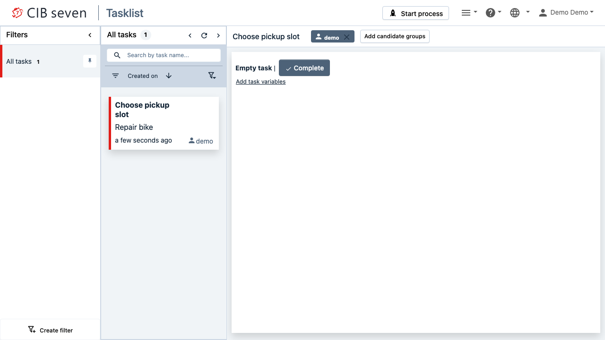
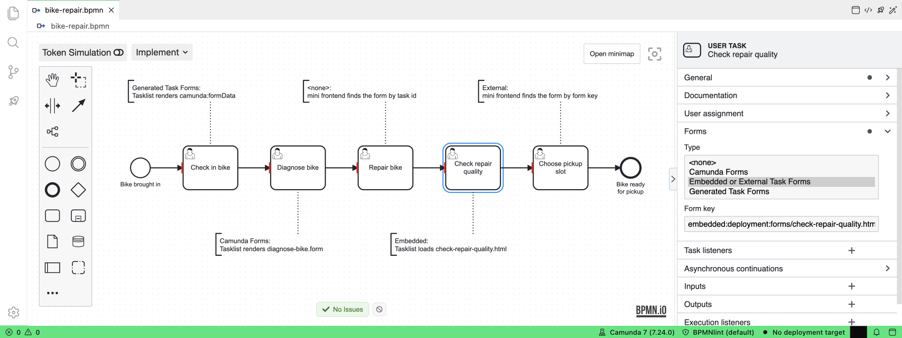
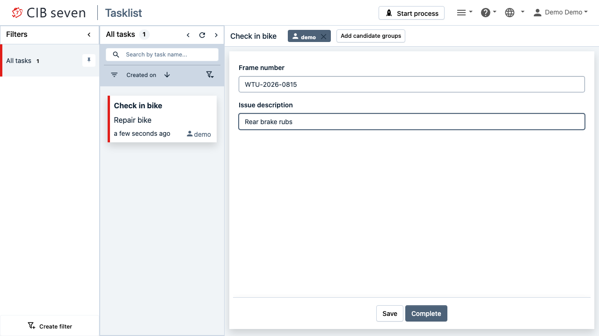
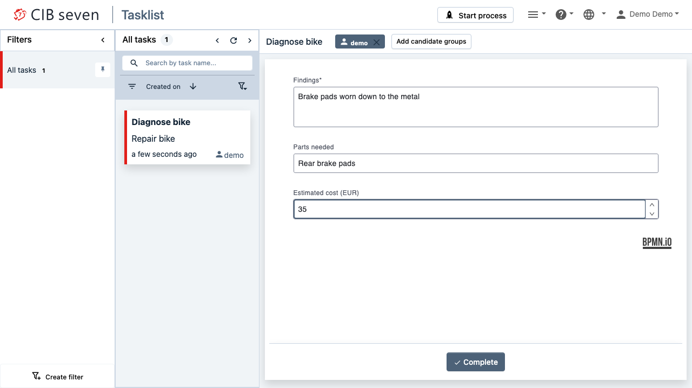
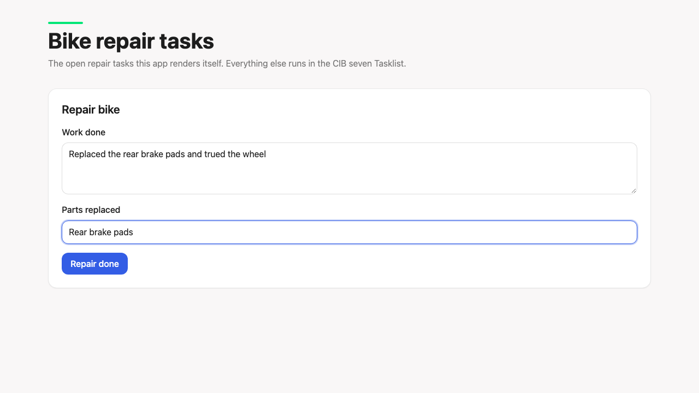
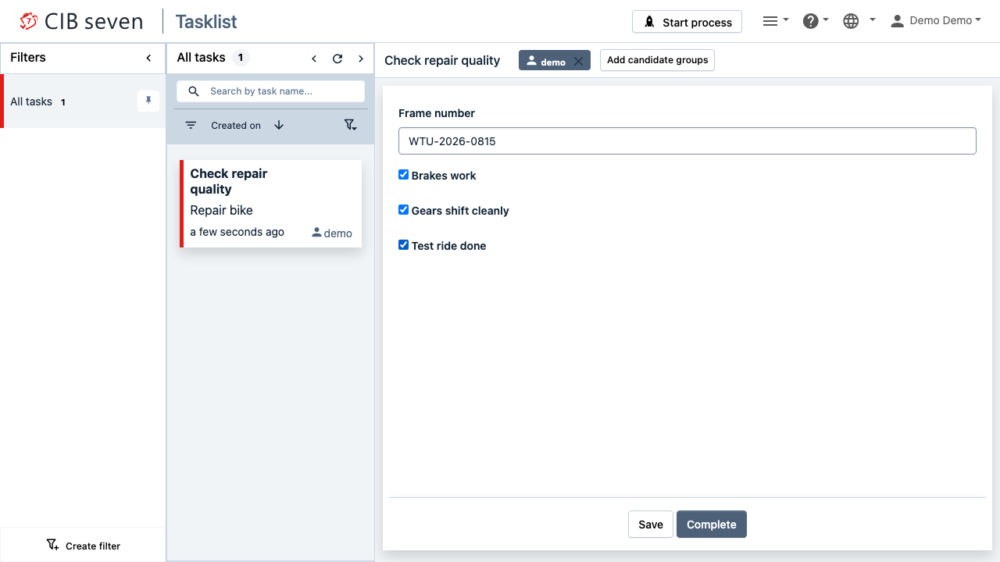
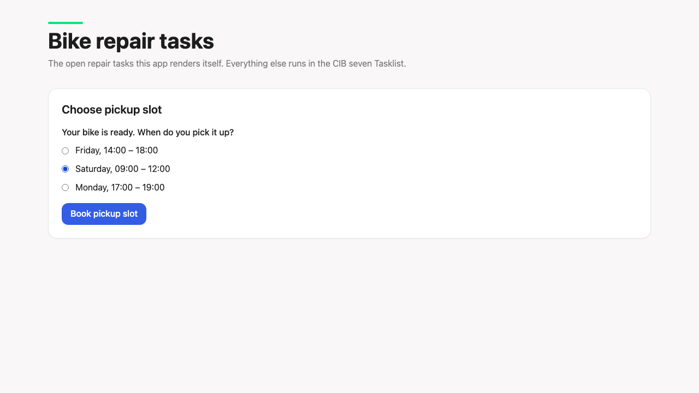
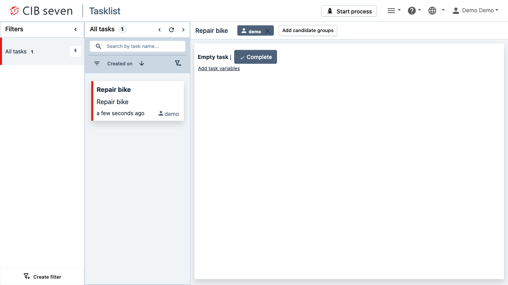

# cibseven-user-task-forms

The Modeler offers four form types for a user task: `<none>`, Camunda Forms, Embedded or External Task Forms and Generated Task Forms. With `<none>` and External you build the UI yourself, so they are hard to tell apart. This recipe runs every form type side by side in one small CIB seven service and shows what the engine stores, who renders the form and when to pick which type.

**Serves:** developers who model user tasks for CIB seven or Camunda 7 and have to choose a form type.



## Ingredients

| Component | Version |
| --- | --- |
| CIB seven | 2.2.0 |
| Spring Boot | 4.1.2 |
| Java | 21 |
| Gradle | 9.8.2 |
| Node.js | 22.12 or newer (`.nvmrc`: 24) |
| React | 19.3.1 |
| Vite | 8.3.5 |
| Playwright | 1.64.1 |

You need a JDK 21 and Node.js. Java versions are pinned in `gradle/libs.versions.toml`, frontend versions in `frontend/package.json`. The service uses an in-memory H2 database, so there is nothing else to start.

## How it works

A customer brings their gravel bike to the MiraVelo workshop. The process `Repair bike` (`bikeRepair`) runs five user tasks in sequence and nothing else. The third task has the same name as the process; both names come from the workshop.

```
Bike brought in → Check in bike → Diagnose bike → Repair bike → Check repair quality → Choose pickup slot → Bike ready for pickup
```

| # | User task | Who | Modeler type | In the BPMN | Rendered by |
| --- | --- | --- | --- | --- | --- |
| 1 | Check in bike (`checkInBike`) | Front desk | Generated Task Forms | `<camunda:formData>` with `frameNumber` (required) and `issueDescription` | CIB seven Tasklist |
| 2 | Diagnose bike (`diagnoseBike`) | Mechanic | Camunda Forms | `camunda:formRef="diagnoseBike"`, `camunda:formRefBinding="deployment"` | CIB seven Tasklist (form-js) |
| 3 | Repair bike (`repairBike`) | Mechanic | `<none>` | nothing | Mini frontend, found by `taskDefinitionKey` |
| 4 | Check repair quality (`checkRepairQuality`) | Workshop lead | Embedded or External | `camunda:formKey="embedded:deployment:forms/check-repair-quality.html"` | CIB seven Tasklist |
| 5 | Choose pickup slot (`choosePickupSlot`) | Customer | Embedded or External | `camunda:formKey="miravelo:choose-pickup-slot"` | Mini frontend, found by form key |

The Modeler column is the "Type" field in the Forms group of the properties panel. Embedded and External share one entry; only the form key tells them apart. In the model itself, an annotation on each task names its form type and who renders it:



Why each type fits its role:

- **Generated** for the front desk: two internal fields, built in a minute.
- **Camunda Forms** for the diagnosis: a richer form (findings, parts, estimated cost) without frontend code.
- **None** for the repair: the workshop app knows its task by its id `repairBike`. The model needs no key.
- **Embedded** for the quality check: it stands in for an existing legacy HTML checklist.
- **External** for the customer: the model names the form `miravelo:choose-pickup-slot`. The customer portal looks it up in its registry, so other processes, such as delivering a new bike, can reuse the form.

The code:

- [`src/main/resources/bike-repair.bpmn`](src/main/resources/bike-repair.bpmn): the process, with one text annotation per task that names its form type.
- [`src/main/resources/forms/diagnose-bike.form`](src/main/resources/forms/diagnose-bike.form): the Camunda Form. Its `id` is `diagnoseBike`.
- [`src/main/resources/forms/check-repair-quality.html`](src/main/resources/forms/check-repair-quality.html): the embedded form, plain HTML with `cam-variable-name`.
- [`src/main/resources/META-INF/processes.xml`](src/main/resources/META-INF/processes.xml): deploys the BPMN and both forms in one deployment. [`WorkshopApplication`](src/main/java/io/miragon/miravelo/workshop/WorkshopApplication.java) turns it on with `@EnableProcessApplication`.
- [`TaskController`](src/main/java/io/miragon/miravelo/workshop/TaskController.java): the business API the mini frontend calls instead of `/engine-rest`. `GET /api/tasks` returns each open task with `id`, `name`, `taskDefinitionKey` and `formKey`. `POST /api/tasks/{id}/complete` takes the variables as a JSON object.
- [`frontend/src/features/tasks/forms/form-registry.ts`](frontend/src/features/tasks/forms/form-registry.ts): both resolution strategies side by side. A task with a form key is looked up in `formsByKey`, a task without one in `formsByTaskDefinitionKey`. The frontend is split by feature: `app/` holds the page shell, `features/tasks/` holds the `api/` calls, the `components/` task list and the `forms/` with their registry.

### What the engine returns

`GET /engine-rest/task/{id}/form` per task, shortened:

| # | Response | `deployed-form` |
| --- | --- | --- |
| 1 | `{"key": "embedded:engine://engine/:engine/task/{id}/rendered-form", "camundaFormRef": null}` | 400 |
| 2 | `{"key": null, "camundaFormRef": {"key": "diagnoseBike", "binding": "deployment", "version": null}}` | 200, the form-js JSON |
| 3 | `{"key": null, "camundaFormRef": null}` | 400 |
| 4 | `{"key": "embedded:deployment:forms/check-repair-quality.html", "camundaFormRef": null}` | 200, the HTML |
| 5 | `{"key": "miravelo:choose-pickup-slot", "camundaFormRef": null}` | 400 |

Every response also contains `"contextPath": "/"`, the context path of the process application. In the Java API, `Task.getFormKey()` is `null` for tasks 1, 2 and 3. Task 2 exposes its form only through `getCamundaFormRef()`.

### The five forms

**1 · Check in bike**: Generated Task Form in the CIB seven Tasklist.



**2 · Diagnose bike**: Camunda Form, rendered with form-js in the Tasklist.



**3 · Repair bike**: no form in the model. The mini frontend finds the form by the task definition key `repairBike`.



**4 · Check repair quality**: embedded HTML form from the deployment, rendered in the Tasklist.



**5 · Choose pickup slot**: external form key. The mini frontend finds the form by `miravelo:choose-pickup-slot`.



### The Tasklist cannot tell None from External

Tasks 3 and 5 look the same in the CIB seven Tasklist: "Empty task", a Complete button and "Add task variables". There is no redirect and no link to the app that owns the task.

| Repair bike (`<none>`) | Choose pickup slot (External) |
| --- | --- |
|  |  |

The web client picks the view from the form definition. A key with `/rendered-form` opens the generated form. A key starting with `embedded:` opens the embedded form. A `camundaFormRef` opens form-js. For everything else it asks its backend for a form reference. The backend only looks for a process variable named `formReference`, finds none and answers `empty-task`. The form key `miravelo:choose-pickup-slot` means nothing to the Tasklist.

## Cook it

```bash
./gradlew bootRun
```

In a second terminal:

```bash
cd frontend
npm ci
npm run dev
```

Start a repair:

```bash
curl -X POST -H 'Content-Type: application/json' -d '{}' \
  http://localhost:8080/engine-rest/process-definition/key/bikeRepair/start
```

Open the CIB seven Tasklist at <http://localhost:8080/webapp> and log in with `demo` / `demo`. Assign each task to yourself before you work on it. Tasks 3 and 5 appear in the mini frontend at <http://localhost:5173>, which polls `GET /api/tasks` every two seconds.

## Taste test

`./gradlew build` runs [`BikeRepairProcessTest`](src/test/java/io/miragon/miravelo/workshop/BikeRepairProcessTest.java). It starts `bikeRepair` from the exploded classes, the same situation as a start from the IDE. For each task it checks the form definition the engine returns: the two generated form fields, the deployed Camunda Form, no form at all, the deployed embedded HTML and the external form key. Then it completes the task and finally expects the process instance to be ended.

`./e2e.sh` checks the same from the jar and through the real UIs. It packages the jar, builds the frontend, starts both and runs [`e2e/forms.spec.ts`](e2e/forms.spec.ts). The spec opens tasks 1, 2 and 4 in the Tasklist and fills their forms, expects "Empty task" for tasks 3 and 5, completes those two through the mini frontend and expects the process instance to be completed. `UPDATE_SCREENSHOT=1 ./e2e.sh` refreshes the screenshots above.

## Take it home

### Which one to pick

| Situation | Pick |
| --- | --- |
| The Tasklist renders the form and you need more than a few fields, a layout or validation | Camunda Forms |
| The Tasklist renders the form and it is a few internal fields | Generated Task Forms. Prefer Camunda Forms as soon as it grows. |
| An existing HTML form, or form logic with `cam-script` inside the Tasklist | Embedded |
| Your own UX, authentication or frontend stack | Your own frontend, with None or External |
| Own frontend, and the app owns this task in this process only | None. Resolve by `taskDefinitionKey`. |
| Own frontend, and the form is reused across processes or the model should name it | External. Resolve by form key. |

None or External comes down to one question: does the form key belong in the model? With None the frontend couples to task ids. With External the model names the form and the frontend only needs a registry from key to form.

To copy:

- **Deployment.** `@EnableProcessApplication` on your application and a `META-INF/processes.xml` that lists every BPMN, `.form` and `.html` file, with `isScanForProcessDefinitions` set to `false`.
- **Business API.** `TaskController` and `OpenTask`. Query with `initializeFormKeys()`, otherwise `getFormKey()` throws.
- **Form registry.** `frontend/src/features/tasks/forms/form-registry.ts`. Add one entry per form.
- **Web client configuration.** The `cibseven.webclient` block in `src/main/resources/application.yaml` and the `com.sun.xml.bind` exclusion in `build.gradle.kts`.

## Kitchen notes

- **Spring Boot auto-deploy skips `.form` and `.html`.** It picks up `bpmn`, `dmn` and `cmmn` only. Adding the suffixes via `camunda.bpm.deployment-resource-pattern` deploys them, but names each resource by its absolute path when started from the IDE and by its bare file name inside the jar. `embedded:deployment:forms/check-repair-quality.html` resolves in neither case. A process application names resources the same way in both.
- **List the resources in `processes.xml`, do not scan.** With scanning and `additionalResourceSuffixes=form,html`, resource names in the Spring Boot jar start with `BOOT-INF/classes/`. The embedded form then works from the IDE and fails from the jar with "The form with the resource name 'forms/check-repair-quality.html' cannot be found". Explicit `<resource>` entries keep the names as written.
- **The `id` inside the `.form` file must equal `formRef`.** `formRef` resolves by form id, not by file name. `diagnose-bike.form` works because its `id` is `diagnoseBike`.
- **The Tasklist shows None and External tasks identically.** See above. If the people who work on such a task also use the Tasklist, tell them where the real UI is.
- **Embedded forms run without AngularJS.** The new web client loads them with the forms SDK: `cam-variable-name`, `cam-variable-type` and `cam-script` work. `ng-*` and `uib-*` markup from old Camunda 7 Tasklist forms does not.
- **`getFormKey()` is `null` for Camunda Forms.** A `formRef` lives in `getCamundaFormRef()`. Both need `initializeFormKeys()` on the task query.
- **The web client needs a JWT secret and its engine URL.** Without `cibseven.webclient.authentication.jwtSecret` (at least 155 Base64 characters) the application does not start. Without `cibseven.webclient.engineRest.url` the login fails, because your own `application.yaml` hides the one the web client ships.
- **`bootJar` fails with a duplicate `jaxb-core`.** The engine starter and the web client bring two JAXB implementations. Exclude `com.sun.xml.bind` from `runtimeClasspath`.
- **Demo only.** The JWT secret is committed, the user is `demo` / `demo`, `/api/tasks` has no authentication and the H2 database lives in memory.

## Variations

Without a process application, keep Spring auto-deploy and add `classpath*:**/*.form` to `camunda.bpm.deployment-resource-pattern`. Camunda Forms still work, because `formRef` resolves by id. Serve the embedded form from `src/main/resources/static/forms/` and reference it as `embedded:/forms/check-repair-quality.html`, so the web client loads it by URL instead of from the deployment. The form then is not versioned with the process. This recipe does not test that variant.

The mini frontend could call `/engine-rest` directly instead of the business API. That saves two classes, but the browser then needs engine credentials and knows engine details such as variable types. The business API keeps both in the service.
